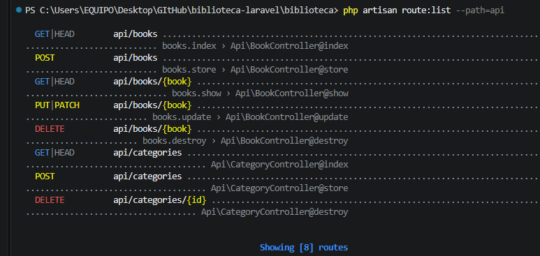
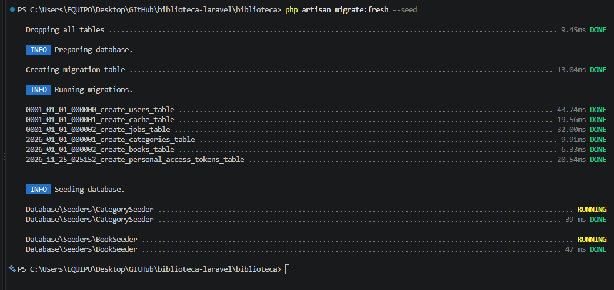
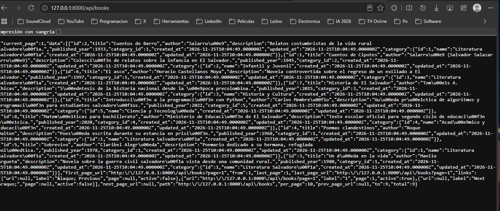
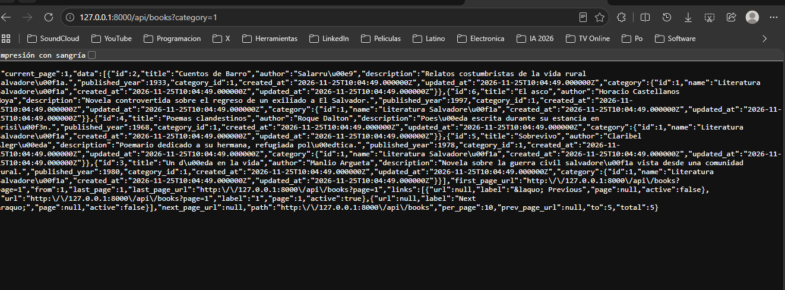
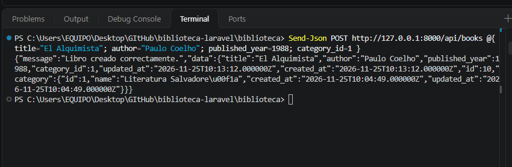
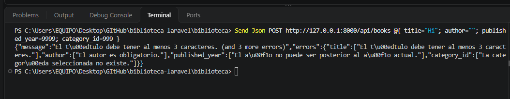
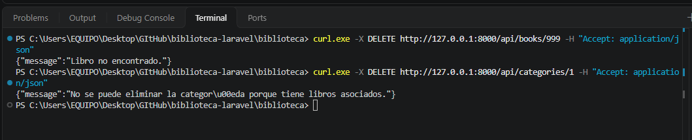
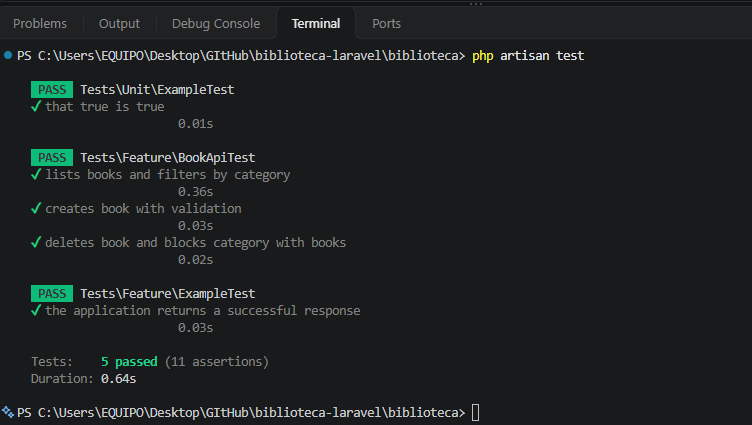

# Biblioteca Municipal de San Miguel — El Salvador

API REST pequena (Laravel + PHP) para gestionar el catalogo de una biblioteca
municipal en El Salvador: CRUD de libros, categorias y filtrado por categoria.

## Evidencias de funcionamiento










## Stack
- PHP 8.2+ y Composer
- Laravel 11/12 (con Sanctum/API scaffolding via `install:api`)
- SQLite (por defecto, ideal para pruebas locales) o MySQL

## Instalacion paso a paso

### 1. Crear el proyecto Laravel
```bash
composer create-project laravel/laravel biblioteca
```

### 2. Habilitar las rutas de API (Laravel 11/12)
```bash
cd biblioteca
php artisan install:api
```
Esto crea `routes/api.php` (con prefijo `/api`) e instala Sanctum.

### 3. Configurar la base de datos (SQLite, lo mas simple)
```bash
touch database/database.sqlite
```
Edita `.env`:
```
DB_CONNECTION=sqlite
# Comenta o borra las lineas DB_HOST, DB_PORT, DB_DATABASE, DB_USERNAME, DB_PASSWORD
```

### 4. Copiar los archivos de este proyecto
Copia el contenido de las carpetas `app/`, `database/`, `routes/` y `tests/`
dentro del proyecto Laravel, reemplazando los archivos existentes.

### 5. Ejecutar migraciones y seeders
```bash
php artisan migrate:fresh --seed
```
Esto crea las tablas `categories` y `books` y carga categorias y libros
salvadorenos de ejemplo (Salarrué, Roque Dalton, Manlio Argueta, Claribel
Alegría, Horacio Castellanos Moya, etc.).

### 6. Levantar el servidor
```bash
php artisan serve
```
La API queda disponible en `http://localhost:8000/api`.

### 7. (Opcional) Ejecutar las pruebas
```bash
php artisan test
```

## Endpoints

| Metodo | Ruta | Descripcion |
|--------|------|-------------|
| GET    | /api/books | Listar libros (paginados). Filtro: `?category={id}` |
| POST   | /api/books | Crear libro |
| GET    | /api/books/{id} | Ver un libro |
| PUT    | /api/books/{id} | Actualizar libro |
| DELETE | /api/books/{id} | Eliminar libro (verifica existencia -> 404) |
| GET    | /api/categories | Listar categorias con conteo de libros |
| POST   | /api/categories | Crear categoria (nombre unico) |
| DELETE | /api/categories/{id} | Eliminar categoria (409 si tiene libros) |

## Ejemplos con curl

Listar todo:
```bash
curl http://localhost:8000/api/books
```

Filtrar por categoria (Literatura Salvadoreña = 1):
```bash
curl "http://localhost:8000/api/books?category=1"
```

Crear libro:
```bash
curl -X POST http://localhost:8000/api/books \
  -H "Content-Type: application/json" \
  -d '{"title":"Cuentos de Barro","author":"Salarrué","description":"Relatos costumbristas","published_year":1933,"category_id":1}'
```

Actualizar libro:
```bash
curl -X PUT http://localhost:8000/api/books/1 \
  -H "Content-Type: application/json" \
  -d '{"description":"Edicion anotada para la biblioteca municipal."}'
```

Eliminar libro:
```bash
curl -X DELETE http://localhost:8000/api/books/1
```

## Validaciones
- `title`: requerido, minimo 3 caracteres.
- `author`: requerido.
- `published_year`: requerido, entero entre 1800 y el año actual.
- `category_id`: requerido, debe existir en `categories`.
- `categories.name`: unico.

Las validaciones devuelven HTTP 422 con los errores en formato JSON.

## Reglas de negocio
- No se puede eliminar un libro inexistente (404).
- No se puede eliminar una categoria con libros asociados (409 Conflict),
  ademas la FK en la base de datos usa `restrictOnDelete()` como segunda barrera.
